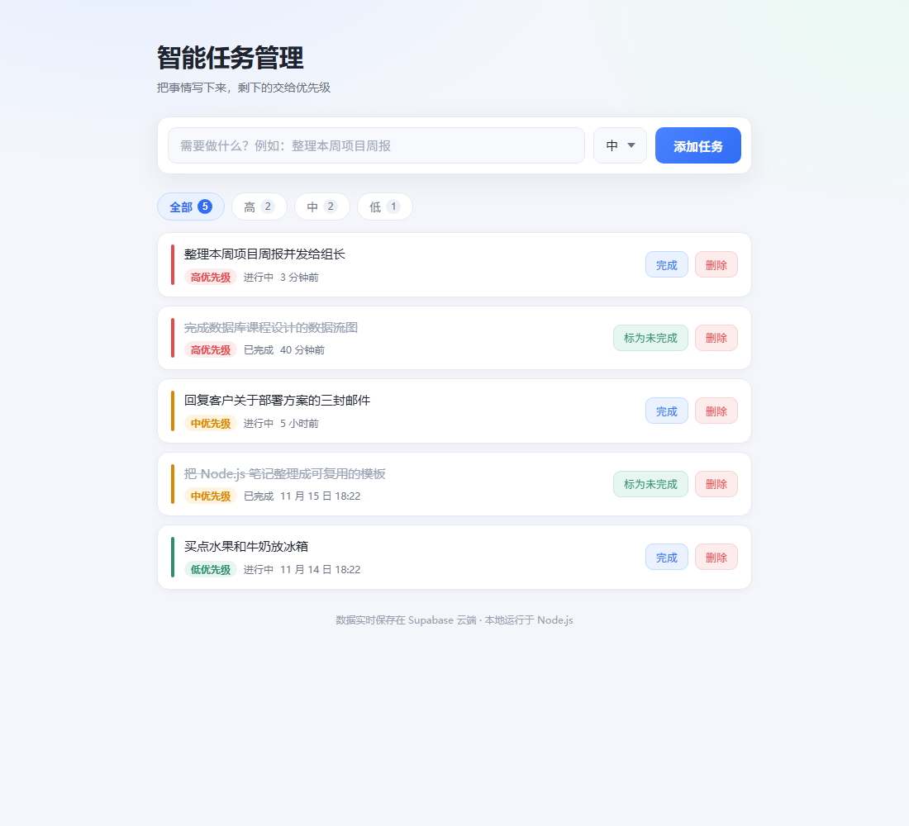

# 智能任务管理系统

Node.js + Express + Supabase（PostgreSQL）实现的任务管理系统。中文界面，支持优先级、完成状态切换、优先级筛选，数据持久化在 Supabase 云端。



## 一、功能清单

| 功能 | 说明 |
| --- | --- |
| 添加任务 | 输入框填写标题 + 优先级下拉（高 / 中 / 低），默认「中」，标题 1–200 字符 |
| 任务列表 | 显示标题、优先级标签、完成状态、创建时间（相对时间显示） |
| 状态切换 | 每条任务一个「完成 / 标为未完成」按钮，点击即时写库 |
| 删除任务 | 每条任务一个「删除」按钮，带淡出动画 |
| 优先级筛选 | 全部 / 高 / 中 / 低，每档带数量角标 |
| 排序 | 按创建时间倒序，最新在最上面 |
| 已完成样式 | 标题加删除线并变灰 |

## 二、目录结构

```
task-manager/
├── package.json          # 依赖与启动脚本
├── .env.example          # 环境变量模板（复制成 .env 再填值）
├── .env                  # 你的真实配置（已被 .gitignore 排除）
├── .gitignore            # 忽略 node_modules 与 .env
├── server.js             # Express 后端 + Supabase REST API 调用
├── vercel.json           # 部署到 Vercel 时的转发配置
├── db/
│   └── schema.sql        # 建表脚本 + 可选 RLS 策略
├── public/
│   ├── index.html        # 页面结构
│   ├── style.css         # 样式（响应式）
│   └── app.js            # 前端逻辑（增删改查 + 筛选 + 渲染）
└── preview.png           # 界面预览图
```

## 三、当前已接入的项目

后端数据层已切换到自己的 Supabase 项目：

| 项 | 值 |
| --- | --- |
| Project URL | `https://gudlbjqspilygetaxiew.supabase.co` |
| 鉴权 key | `sb_publishable_...`，放在 `.env` 的 `SUPABASE_ANON_KEY` |
| 区域 | Southeast Asia (Singapore) |
| 数据表 | `tasks` |

## 四、跑起来

### 第 1 步：确认 `.env`

```dotenv
SUPABASE_URL=https://gudlbjqspilygetaxiew.supabase.co
SUPABASE_ANON_KEY=sb_publishable_JO566UJ_YGxwZux-W-VKCQ_sRz5FWEF
PORT=3000
```

换 key 只改 `.env`，代码不用动。后端优先读 `SUPABASE_ANON_KEY`，找不到才退回 `SUPABASE_SERVICE_KEY`，两种 key 都支持。

### 第 2 步：启动

```powershell
cd "C:\Users\x1763\Doubao\chats\2026-11-16\new-chat\task-manager"
npm start
```

看到这三行就成功了：

```
智能任务管理系统已启动：http://localhost:3000
数据库：https://gudlbjqspilygetaxiew.supabase.co
鉴权角色：publishable/anon
```

依赖已装好，换电脑后先 `npm install`。改后端代码可用 `npm run dev`（Node 22 自带 `--watch`）。

### 第 3 步：验收

- 输入「测试任务」、优先级选「高」→ 添加 → 列表顶部出现，标签「高优先级」，角标「全部 / 高」各 +1。
- 点「完成」→ 标题变灰 + 删除线，按钮变「标为未完成」。
- 刷新页面 → 数据还在，说明确实落库了。
- 点筛选「高」→ 只剩高优先级；点「低」→ 显示「当前没有「低」优先级的任务」。
- 点「删除」→ 条目淡出消失。

## 五、数据表结构

| 字段 | 类型 | 说明 |
| --- | --- | --- |
| `id` | bigint | 主键，`generated by default as identity` 自增 |
| `title` | text | 任务标题，后端限制 1–200 字符 |
| `priority` | text | 直接存中文 `高` / `中` / `低`，带 CHECK 约束 |
| `completed` | boolean | 默认 `false` |
| `created_at` | timestamptz | 默认 `now()`，列表按它倒序 |

注意：`priority` 存的是中文值。若要改成英文 `high/medium/low`，需同步改 `server.js` 的 `VALID_PRIORITIES` 和 `public/app.js` 的 `TO_DB` / `FROM_DB` 映射。

建表脚本在 `db/schema.sql`，在 Supabase SQL Editor 跑一次即可（幂等，重复跑安全）。

## 六、数据权限（重要）

现在用的是 publishable key（anon 角色）。当前这张表 RLS 处于关闭状态，功能正常，但意味着：任何拿到 `Project URL + publishable key` 的人都能读写这张表。

想收紧，在 SQL Editor 跑下面这段（最小可用的匿名读写策略，功能不变）：

```sql
alter table public.tasks enable row level security;

create policy "tasks_select_anon" on public.tasks
  for select to anon using (true);

create policy "tasks_insert_anon" on public.tasks
  for insert to anon with check (true);

create policy "tasks_update_anon" on public.tasks
  for update to anon using (true) with check (true);

create policy "tasks_delete_anon" on public.tasks
  for delete to anon using (true);
```

跑完功能照旧。真要做到「公网拿 key 也读不到」，得接 Supabase Auth + 按 `user_id` 建策略，那是下一步的事。

哪天换成 secret key（`sb_secret_...`），把 `SUPABASE_ANON_KEY` 那行删掉、改填 `SUPABASE_SERVICE_KEY`，否则会优先用 anon 那条。

## 七、API 说明

| 方法 | 路径 | 参数 | 说明 |
| --- | --- | --- | --- |
| GET | `/api/tasks` | `?priority=高/中/低`（可选，需 URL 编码） | 列表，按 `created_at` 倒序 |
| POST | `/api/tasks` | body: `{"title":"...","priority":"高"}` | 新建，返回 201 + 新记录 |
| PATCH | `/api/tasks/:id` | body: `{"completed":true}` | 切换完成状态 |
| DELETE | `/api/tasks/:id` | — | 删除 |

前端为了做数量角标，一次性拉全量再本地筛选；后端 `priority` 参数留给其他调用方（小程序、Postman 等）。

错误统一返回 `{"error":"提示文字"}`，前端以顶部红色横幅展示 4 秒。

## 八、常见问题

| 现象 | 原因与处理 |
| --- | --- |
| 启动时报「缺少 Supabase 配置」 | 没有 `.env`，或没放在 `task-manager` 目录下 |
| `relation "tasks" does not exist` | 建表脚本没在 SQL Editor 跑过 |
| `invalid api key` / 401 | key 复制时带了空格或换行 |
| `new row violates row-level security policy` | RLS 开着但缺 insert 策略，跑第六节的 SQL |
| 列表永远为空、插入却报错 | 同上，读被 RLS 静默过滤成空数组 |
| `getaddrinfo ENOTFOUND` | URL 写错，或免费项目 7 天无活动被暂停（控制台 Restore） |
| 新增报「优先级只能是 高 / 中 / 低」 | 前端传了英文值，检查代码是否被改过 |
| 端口占用 EADDRINUSE | 改 `.env` 里 `PORT=3001`，或 `Get-NetTCPConnection -LocalPort 3000` 找到进程结束 |
| 控制台中文乱码 | 终端编码问题，`chcp 65001`，不影响页面 |

## 九、部署到线上（可选）

1. 项目推到 GitHub（`.gitignore` 已排除 `.env`）。
2. Vercel → **Add New Project** → 导入仓库。
3. 根目录已有 `vercel.json`。
4. **Settings → Environment Variables** 加 `SUPABASE_URL`、`SUPABASE_ANON_KEY`。
5. 部署完成访问域名即可。

## 十、可继续扩展

- 加截止日期字段，做逾期高亮和「今日待办」
- 用 Supabase Realtime 订阅，多标签页同步刷新
- 接入 Supabase Auth，`tasks` 加 `user_id` 并配 RLS 策略，做成多人各自的任务板
- 加拖拽排序 / 搜索框 / 暗色模式
